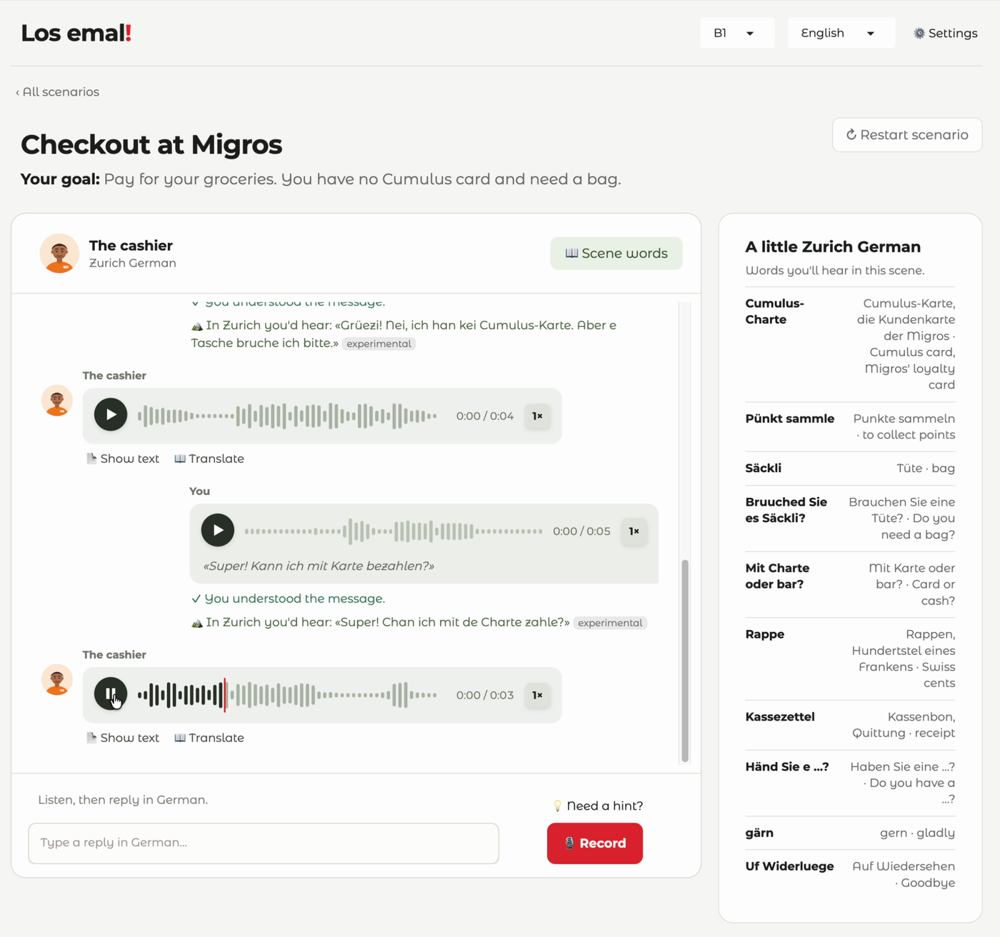

# Los emal! — understand Zurich German with Apertus

*«Los emal!» is Zurich German for "Listen!"*



Newcomers in Zurich learn Standard German in class, and then the baker, the neighbour and the
colleague at the coffee machine answer in *Züritüütsch*. Answering in Standard German is socially
perfectly normal; **understanding** the dialect is the real barrier.

**Los emal!** is a listening trainer for exactly this situation. In nine everyday Zurich scenes
(bakery, Migros checkout, Kreisbüro, GP's practice, the neighbour, coffee break at work, flat viewing,
restaurant, tram stop) a local speaks Zurich German in voice messages, the learner listens — text
hidden by default — and answers in Standard German by voice. Apertus 1.5 plays the local, explains
the hardest dialect words on request and checks whether the learner understood. The app trains
understanding: it neither grades the learner's dialect nor corrects their German.

Hack Apertus 2026 · Track 2B (own project). Code and technical report: [`track_2b/`](track_2b/)
([PDF](track_2b/AlinaPonomareva_Report.pdf)). Demo video: [youtu.be/dR4Ah5yqL10](https://youtu.be/dR4Ah5yqL10)

## Quick start

```bash
cd track_2b
cp .env.example .env        # put your Apertus endpoint and key in LLM_* variables
make run                    # Docker → http://localhost:7860
```

The first build downloads about 6 GB (Python packages and the speech models, which are baked into
the image) and takes a few minutes. Give Docker at least 8 GB of memory (Docker Desktop → Settings →
Resources): the container peaked at 6.7–7.3 GB in our runs. On CPU the speech models are slow, so a
turn takes 20–50 s; natively on Apple Silicon the next line could be played 8–12 s after the learner
stopped speaking (measured on the demo recording; technical report, sections 5 and 8).

**Who writes the dialect.** By default (`DIALOGUE=de`) Apertus writes the local's lines in Swiss
Standard German, and Apertus with a Zurich style guide translates them into Zurich German;
`DIALOGUE=gsw` lets Apertus write Zurich German itself. `GSW_BASE_URL`, `GSW_MODEL` and `GSW_API_KEY`
send the translation step to any other OpenAI-compatible endpoint, for example our research model
(below, gated on Hugging Face) on a Mac with `pip install mlx-lm`:

```bash
mlx_lm.server --model alise441/apertus-v1.5-8b-de-to-zurich-mlx-4bit --port 8080
# .env: GSW_BASE_URL=http://host.docker.internal:8080/v1   (native run: http://localhost:8080/v1)
```

## How it works

Per learner turn ([diagram](track_2b/docs/architecture.md)): Whisper transcribes the answer; Apertus
70B writes the local's next line in Swiss Standard German; a translator turns it into Zurich German,
followed by a checked list of greetings and stock phrases and fixes for slips we saw repeatedly;
Qwen3-TTS speaks it with a synthetic voice. In parallel, Apertus checks whether the answer fits what
the local said, and the translator shows how a local would say the learner's sentence. Translations,
hard words and answer ideas are prepared in the background and shown on request. Each scene's first
line is prepared in advance, so a scene starts at once.

## Why it is built this way

Our evaluation (technical report, section 5) shaped the design:

- **Whisper understands spoken Zurich German far better than Apertus' experimental audio input**
  (WER 30.9 % vs 88.8 % on 100 SwissDial clips), so Whisper handles speech input (E1).
- **Apertus speaks Zurich German reasonably, but cannot judge it.** Asked whether a sentence is
  Zurich German, Standard German or Bernese German, 70B and 8B were right in only 60 % and 58 % of
  150 cases, below the 67 % of always answering "no" (E2). So the app never grades dialect.
- **A short Zurich style guide** raises the share of Zurich forms (*hät, de, gsi* instead of *het,
  dr, gsy*) in Apertus' output from 61 % to 70 % (70B), but not chrF (58.6 either way, E3); Bernese
  and Basel forms still slip in. The translation prompt uses it.
- **Focused calls beat one big prompt.** Inside the role-play prompt Apertus noticed 3 of 20
  misunderstandings; a separate comprehension check notices 18 of 20, without a false alarm on 43
  fitting answers (E4).
- **Standard German first, dialect second.** When Apertus wrote the dialect itself, half of its
  lines on a scripted path were near-copies of the sample dialogue in its prompt; writing Standard
  German and translating keeps the role-play coherent (A/B, section 5).

## Research: fine-tuning Apertus as a Zurich German translator

Five minutes of LoRA fine-tuning of Apertus v1.5 8B on 3,615 SwissDial sentence pairs raise chrF on
held-out sentences from 58.6 (Apertus 70B with the style guide) to 76.7, with 100 % Zurich word forms
(E5). SwissDial is licensed CC BY-NC 4.0, while the hackathon terms release submitted code and
weights under Apache-2.0, so this model is **not part of the submission**: it is published
separately for non-commercial research as
[alise441/apertus-v1.5-8b-de-to-zurich](https://huggingface.co/alise441/apertus-v1.5-8b-de-to-zurich)
(4-bit MLX: [alise441/apertus-v1.5-8b-de-to-zurich-mlx-4bit](https://huggingface.co/alise441/apertus-v1.5-8b-de-to-zurich-mlx-4bit)).
The submitted app uses Apertus 70B for this step; the demo video uses the research translator and
says so on screen. An Apache-licensed translator would need openly licensed conversational
Standard German–Zurich German data, which we did not find.

## Sovereign by design

Apertus is called through any OpenAI-compatible endpoint: a Swiss-hosted API (Public AI,
Infomaniak) or a self-hosted vLLM server, and so is the optional translator. Speech recognition
(Whisper) and speech synthesis (Qwen3-TTS) are open-weights models baked into the container image,
so the whole system can run on-premise or air-gapped. The app's voices are synthetic (designed with
Qwen3-TTS VoiceDesign); the male voice in the demo video is a native speaker's, used with consent and
not part of the repository.

## Licence

Code: Apache-2.0. Documentation and test data: CC-BY-4.0 / CDLA-Permissive-2.0
(see the Hack Apertus terms). The research model above: CC BY-NC 4.0, separate from this submission.
