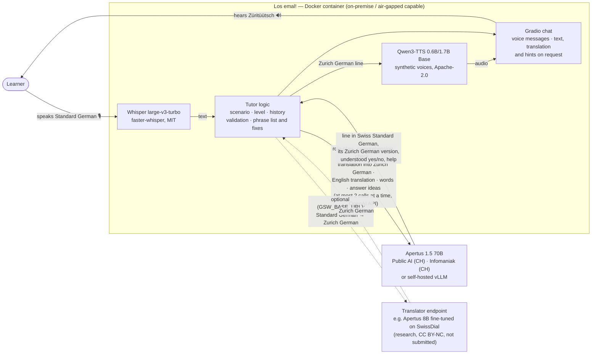

# Architecture

**One learner turn.**

1. Whisper transcribes the spoken answer.
2. **Role-play:** Apertus 70B writes the local's next line in Swiss Standard German (`DIALOGUE=de`,
   default; with `DIALOGUE=gsw` it writes Zurich German itself).
3. **Translation:** the translator — Apertus 70B with the Zurich style guide of E3, or the endpoint in
   `GSW_BASE_URL` — turns the line into Zurich German. Sentences that are greetings, thanks, farewells
   or stock phrases of the scenes come from a checked list (55 entries); regular expressions fix
   slips the translators made repeatedly (other dialects' forms, invented words, a dropped *Sie*).
4. In parallel with 2–3: a **comprehension check** (does the answer fit what the local said?) and the
   learner's sentence **the way a local would say it** (translator, marked experimental).
5. **Qwen3-TTS** speaks the line; the chat shows it once it can be heard.
6. In the background: the English translation (from the Standard German original), 1–3 hard words
   and two answer ideas, shown on request.

That is about seven model calls per turn (five to Apertus, two to the translator), at most two at a
time per endpoint. They are separate, focused calls because inside one big role-play prompt the model
missed most misunderstandings and mixed up the learner's sentence with its own line (technical
report, E4). Each scene's first line, with its translations, words and answer ideas, is prepared in
advance (`data/openings.json`) and synthesised at start-up, so a scene starts at once.

**What runs where.**

| Component | Model | Licence | Runs |
|---|---|---|---|
| Role-play, translation into Zurich German, checks, help | Apertus 1.5 70B (8B possible) | Apache-2.0 | any OpenAI-compatible endpoint: Swiss-hosted API or local vLLM |
| Optional translator (research) | Apertus 1.5 8B, LoRA on SwissDial (E5) | CC BY-NC 4.0, not part of the submission | any OpenAI-compatible endpoint, e.g. `mlx_lm.server` on a Mac |
| Speech recognition | Whisper large-v3-turbo | MIT | in the container (CPU int8 / CUDA); MLX on Apple Silicon |
| Speech synthesis | Qwen3-TTS 12Hz Base | Apache-2.0 | in the container (CPU / CUDA / MPS) |
| Reference voices | generated once with Qwen3-TTS VoiceDesign | — | shipped as wav in `data/voices/` |

Build time downloads the Python packages and the open speech weights, which are baked into the
image. At runtime, with a local Apertus endpoint, the system needs no external network.
