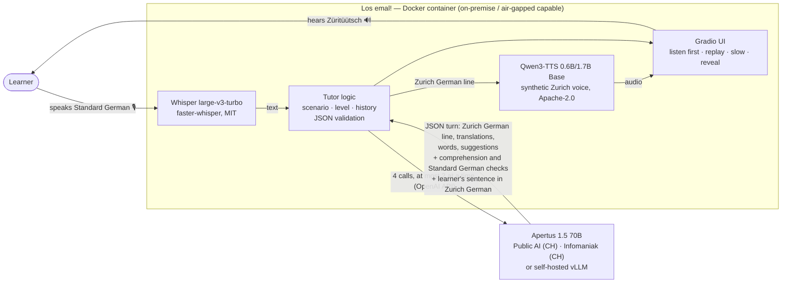

# Architecture

**Four Apertus calls per learner turn, at most two at a time.** The role-play call returns a single
JSON object containing the next line in Zurich German, its Standard German and help-language
translations, 1–3 hard dialect words and two suggested answers. While it runs, three short calls
follow one another: a check of the learner's Standard German (verdict, corrected sentence, tip), a
check whether the answer fits what the local said, and the learner's sentence the way a local would
say it, with the translation prompt measured in E3. Inside the role-play call the model passed almost
every learner error as correct, missed most misunderstandings and mixed up the learner's sentence with
its own line (technical report, E4); as separate, focused calls these tasks work.

**What runs where.**

| Component | Model | Licence | Runs |
|---|---|---|---|
| Dialogue, translation, feedback | Apertus 1.5 70B (8B possible) | Apache-2.0 | any OpenAI-compatible endpoint: Swiss-hosted API or local vLLM |
| Speech recognition | Whisper large-v3-turbo | MIT | in the container (CPU int8 / CUDA); MLX on Apple Silicon |
| Speech synthesis | Qwen3-TTS 12Hz Base | Apache-2.0 | in the container (CPU / CUDA / MPS) |
| Reference voices | generated once with Qwen3-TTS VoiceDesign | — | shipped as wav in `data/voices/` |

Build time downloads the Python packages and the open speech weights, which are baked into the
image. At runtime, with a local Apertus endpoint, the system needs no external network.
